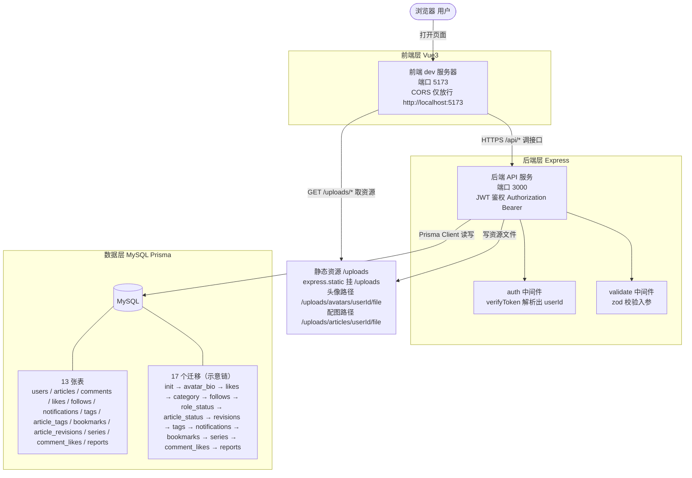
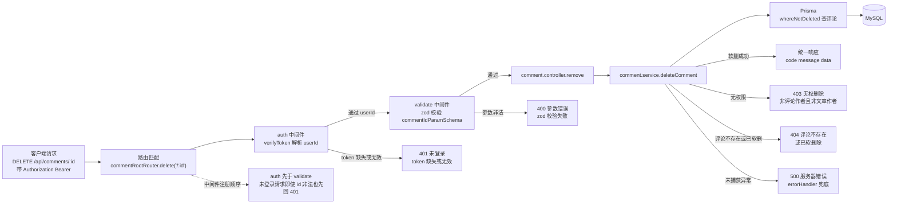
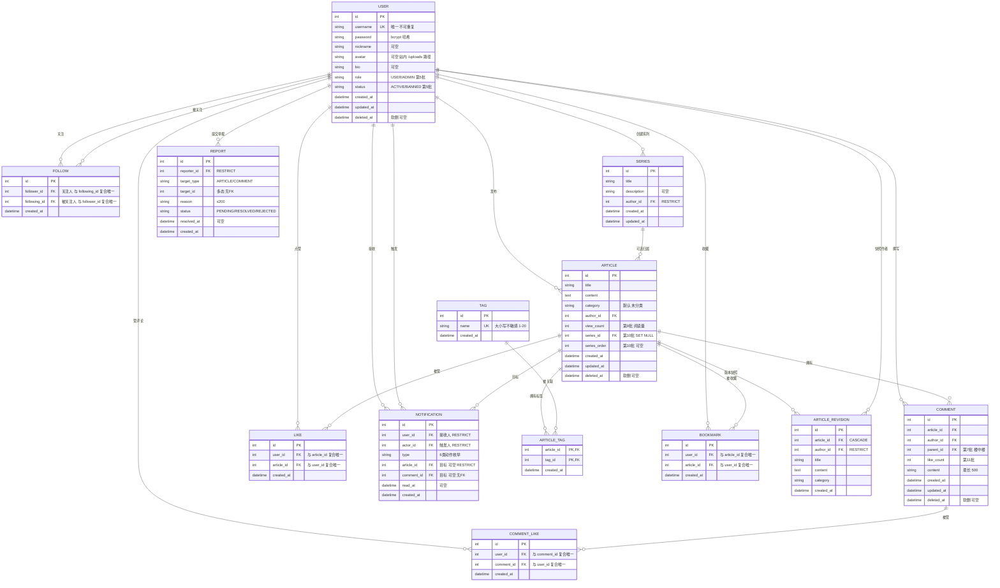
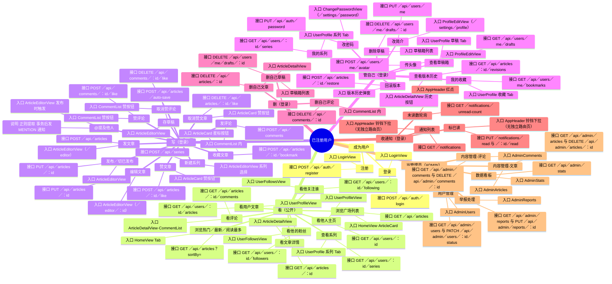

<!-- 文档：ARCHITECTURE.md | 定位：架构说明 | 核心：前后端分层、请求链路、ER 图与前端路由组件树。 -->

# 系统架构图（ARCHITECTURE）

> 本文档用 Mermaid 画「关系」，不重复 API.md / README / DB.md 的字段清单。  
> 六张图：A 系统架构 / B 后端请求链路 / C 数据库 ER / D 用户功能地图 / E 接口全景 / F 前端路由+组件树。  
> 视图文档，冲突以 API.md / DB.md 为准。

---

## A · 系统架构图

三层：前端 (Vue3) / 后端 (Express) / 数据层 (MySQL + Prisma)。标注端口、鉴权方式、静态资源路径、CORS 白名单；MySQL 层一眼看到「13 张表 + 17 个迁移」的数据规模。

---

## B · 后端请求链路图（带鉴权写请求）

以 `DELETE /api/comments/:id` 为例，画出一次写请求的完整中间件顺序与错误分支。**中间件注册顺序为 `auth` → `validate`**（见 `comment.routes.js:14`），因此未登录请求即便参数非法也先回 401。统一响应体 `{ code, message, data }`。第 5 批之后新增的所有 admin / report 接口也是同一鉴权链（`auth` → `requireAdmin` → `validate`），不再单独画。

---

## C · 数据库 ER 图

13 张表，标出外键、唯一约束、软删列。关键差异：`users` / `articles` / `comments` 有 `deleted_at`（软删除），`likes` / `follows` / `bookmarks` / `comment_likes` / `series` **没有**（物理删除，因为唯一约束 + 「关系 = 行存在」不变式）；`tags` / `article_tags` / `article_revisions` / `notifications` / `reports` 也均无软删（tags 为共享词典、article_tags 为联结表、article_revisions 为历史快照、notifications / reports 为事件记录）。

> `likes` 表无 `deleted_at`：取消点赞是物理 DELETE，而非软删——避免与 `(user_id, article_id)` 唯一约束冲突（详见 DB.md 第十一批说明）。
> `follows` 表同样无 `deleted_at`：取关是物理 DELETE；`(follower_id, following_id)` 复合唯一即「一段关注关系只有一行」，重复关注由唯一约束兜底、应用层返回幂等成功（第 4 批）。
> `bookmarks` / `comment_likes` / `series` 同样无 `deleted_at`（物理删，与 likes / follows 同族）；`article_revisions` 的 `article_id` 是 CASCADE、`author_id` 是 RESTRICT；`articles.series_id` 是 SET NULL（全库唯一）。

---

## D · 用户功能地图（mindmap）

中心=已注册用户；分支：看（公开）／写（登录）／管自己（登录）／删（登录）／收通知（登录）／当管理员（ADMIN）。画「功能 → 入口（页面/组件） → 接口」的映射，不列功能清单。

---

## E · 接口全景图（flowchart）

59 个接口按模块聚合（auth+health 5 / user 13 / article 12 / like 3 / comment 3 / comment_like 3 / bookmark 4 / notification 4 / admin 7 / report 3）。画四类关系——这正是 API.md 接口表看不出来的部分：**① 模块归属独立 service** **② 跨模块 service 复用** **③ 跨 service 共享数据表** **④ 同模块跨 service**。所有 service 均经 Prisma 直连表，无 service 间链式调用。不重复 API.md 接口表。

```mermaid
flowchart TB
  subgraph MOD[接口按模块聚合（共 59 个）]
    authH["auth + health 5\nregister / login / me / password / health"]
    userM["user 模块 13\nme / avatar / :id / :id/articles / me/likes / follow / followers / following / me/drafts / me/drafts/:id / revisions / restore / series"]
    artM["article 模块 12\n列表 / 详情 / 发布 / 编辑 / 删除 / auto-save / upload-image / 标签 / 分类筛选 / revisions / restore / view"]
    likeM["like 模块 3\nPOST+DELETE /like + GET /liked"]
    cmtM["comment 模块 3\nPOST /comments + GET /:id/comments + DELETE /:id"]
    cmtLikeM["comment_like 模块 3\nPOST+DELETE /comments/:id/like + GET /liked"]
    bmM["bookmark 模块 4\nPOST+DELETE /bookmark + GET /bookmarked + GET /users/me/bookmarks + view"]
    notiM["notification 模块 4\nGET /notifications + unread-count + PUT /read + /:id/read"]
    adminM["admin 模块 7\nstats / users / users/:id/status / articles / articles/:id / comments / comments/:id"]
    rptM["report 模块 3\nPOST /reports + GET /admin/reports + PUT /admin/reports/:id"]
  end

  subgraph SVC[Service 层（各模块独立 service，共 14 个）]
    authSvc["Auth service"]
    userSvc["User service"]
    artSvc["Article service"]
    likeSvc["Like service"]
    cmtSvc["Comment service"]
    followSvc["Follow service"]
    notiSvc["Notification service"]
    tagSvc["Tag service"]
    bmSvc["Bookmark service"]
    seriesSvc["Series service"]
    rptSvc["Report service"]
    cmtLikeSvc["CommentLike service"]
    viewSvc["View service"]
    adminSvc["Admin service"]
  end

  subgraph DBT[数据层（Prisma 直连，13 张表）]
    usersTable["users 表"]
    artTable["articles 表"]
    cmtTable["comments 表"]
    likesTable["likes 表"]
    followsTable["follows 表"]
    notiTable["notifications 表"]
    tagsTable["tags / article_tags 表"]
    bmTable["bookmarks 表"]
    revTable["article_revisions 表"]
    seriesTable["series 表"]
    cmtLikeTable["comment_likes 表"]
    rptTable["reports 表"]
  end

  authH --> authSvc
  userM --> userSvc
  artM --> artSvc
  likeM --> likeSvc
  cmtM --> cmtSvc
  cmtLikeM --> cmtLikeSvc
  bmM --> bmSvc
  notiM --> notiSvc
  adminM --> adminSvc
  rptM --> rptSvc

  authSvc --> usersTable
  userSvc --> usersTable
  likeSvc --> likesTable
  followSvc --> followsTable
  artSvc --> artTable
  cmtSvc --> cmtTable
  notiSvc --> notiTable
  tagSvc --> tagsTable
  bmSvc --> bmTable
  seriesSvc --> seriesTable
  cmtLikeSvc --> cmtLikeTable
  rptSvc --> rptTable
  viewSvc --> artTable

  artSvc -. "article.service 导出 toArticleListItem / ARTICLE_DETAIL_SELECT / ARTICLE_SORT_MAP（第 2 批）" .-> userSvc
  userSvc -. "user.service 直接查 likes 表（不经 like.service）" .-> likesTable
  userM -. "follow 四接口走独立 follow.service（挂在 user.routes 下，第 4 批）" .-> followSvc
  followSvc --> followsTable
  notiSvc -. "被 comment / follow / like / report 四处触发" .-> cmtSvc
  notiSvc -. "被 comment / follow / like / report 四处触发" .-> followSvc
  notiSvc -. "被 comment / follow / like / report 四处触发" .-> likeSvc
  notiSvc -. "被 comment / follow / like / report 四处触发" .-> rptSvc
  rptSvc -. "事务提交后发 REPORT_RESOLVED / REPORT_REJECTED 通知" .-> notiSvc
  adminSvc -. "复用共享 select 与 deleteComment（评论级联软删）" .-> cmtSvc
```

---

## F · 前端路由 + 组件树（graph）

画三类关系：**① 路由嵌套（壳+子页、双路径共用组件）② 组件复用（ArticleCard / Pagination 被哪几处用）③ store 订阅（likedStore / followingStore / bookmarksStore / notificationStore 消费与 reset 触发链）**。不重复 README 目录。

```mermaid
graph TB
  subgraph ROUTE[前端路由 router/index.js]
    rLogin["/login → LoginView\nlayout: blank 无 Header"]
    rHome["/ → HomeView\n落地页 静态引入"]
    rDetail["/article/:id → ArticleDetailView"]
    rEditor["/editor → ArticleEditorView\nrequiresAuth"]
    rEditorId["/editor/:id → ArticleEditorView\nrequiresAuth 双路径"]
    rUser["/user/:id → UserProfileView\n公开"]
    rFollows["/user/:id/follows/:type → UserFollowsView\n公开 type 白名单 beforeEnter"]
    rSettings["/settings → SettingsView 壳\nrequiresAuth redirect profile"]
    rPwd["/settings/password → ChangePasswordView\n子页"]
    rProfile["/settings/profile → ProfileEditView\n子页"]
    rAdmin["/admin → AdminLayout 壳\nrequiresAdmin"]
    rStats["/admin/stats → AdminStats"]
    rUsers["/admin/users → AdminUsers"]
    rArts["/admin/articles → AdminArticles"]
    rCmts["/admin/comments → AdminComments"]
    rReps["/admin/reports → AdminReports"]
  end

  subgraph COMP[组件]
    card["ArticleCard\n已赞态来自 likedStore"]
    editorComp["ArticleEditorView\n新建+编辑共用"]
    clist["CommentList\n内含 Pagination"]
    ceditor["CommentEditor 主评论框"]
    pag["Pagination\n@change 翻页 不 watch"]
    header["AppHeader\n监听 AUTH_CLEARED_EVENT\n未读红点来自 notificationStore"]
    followsComp["UserFollowsView\n粉丝/关注列表 复用 Pagination"]
    profileComp["UserProfileView\n关注按钮 + 主页入口 + 收藏/系列 Tab"]
    badge["UserBadge 管理员徽章"]
    toc["ArticleToc 侧边目录"]
    adminSide["AdminLayout 侧边栏"]
  end

  subgraph STORE[Store]
    liked["likedStore\n已赞 id 集合 Set"]
    following["followingStore\n已关注 id 集合 Set"]
    user["userStore\nsetToken 联动 reset"]
    bookmarks["bookmarksStore\n已收藏 id 集合 Set"]
    notification["notificationStore\n未读数 + 30s 轮询"]
  end

  rSettings --- rPwd
  rSettings --- rProfile
  rEditor --> editorComp
  rEditorId --> editorComp
  rAdmin --- rStats
  rAdmin --- rUsers
  rAdmin --- rArts
  rAdmin --- rCmts
  rAdmin --- rReps

  rHome --> card
  rUser --> card
  rDetail --> card
  rDetail --> clist
  rDetail --> toc
  card --> pag
  clist --> pag
  clist --> ceditor

  card --> liked
  header --> liked
  header --> user
  header --> notification
  user -->|setToken 触发 reset| liked
  user -->|setToken 触发 reset| following
  user -->|setToken 触发 reset| bookmarks
  header -. "监听 AUTH_CLEARED_EVENT\n→ setToken('')" .-> user

  rFollows --> followsComp
  rUser --> profileComp
  followsComp --> pag
  profileComp --> following
  header -. "ensureLoaded(user.id)\n按钮初始态 + 主页计数" .-> following
  profileComp --> bookmarks
  rStats --> adminSide
  rUsers --> adminSide
  rArts --> adminSide
  rCmts --> adminSide
  rReps --> adminSide
  profileComp --> badge
```

