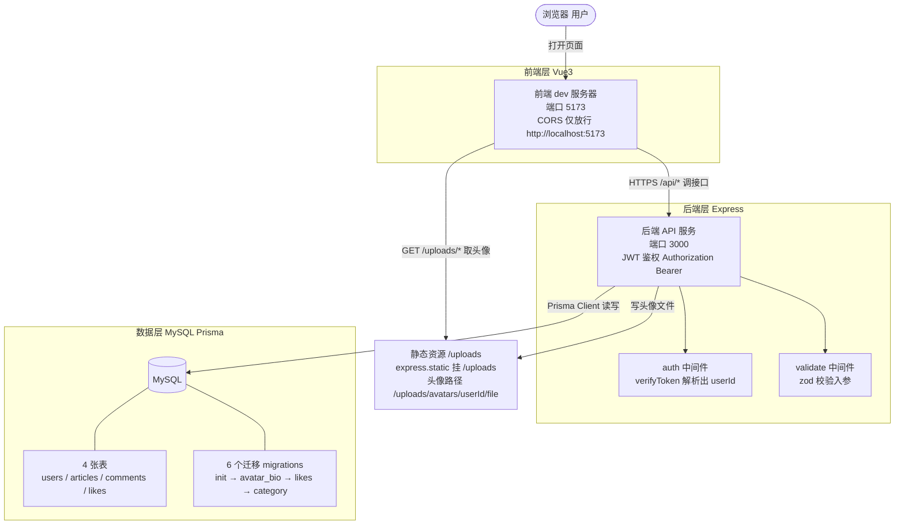
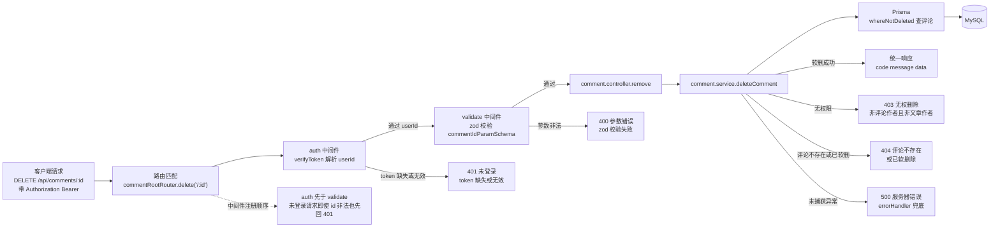
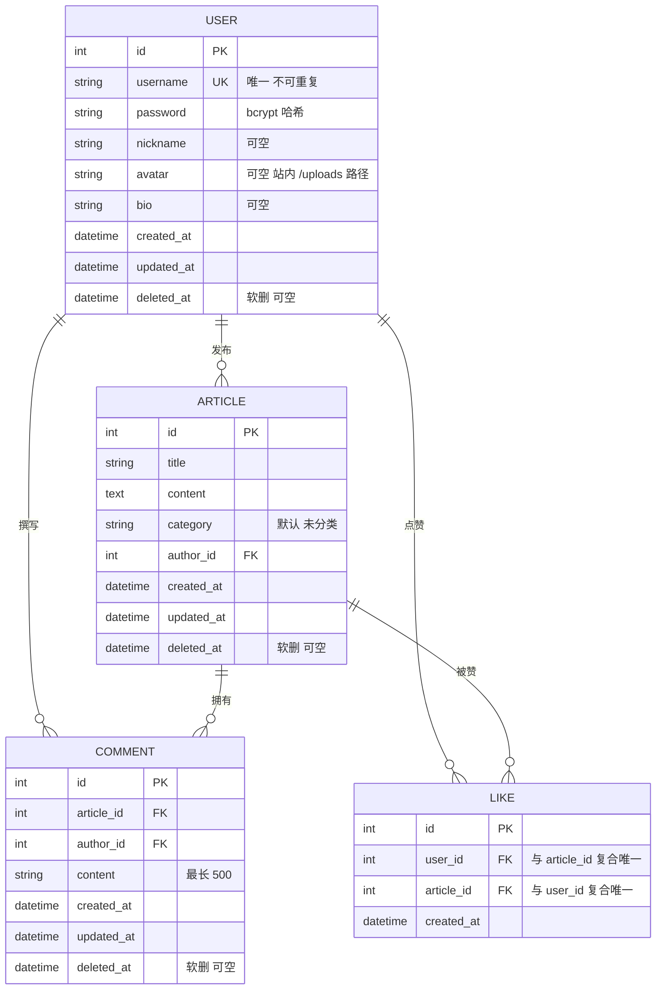
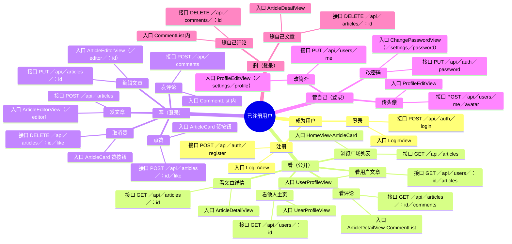
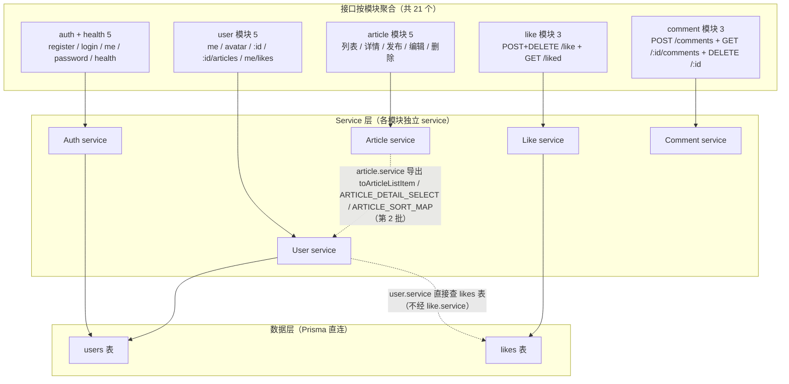
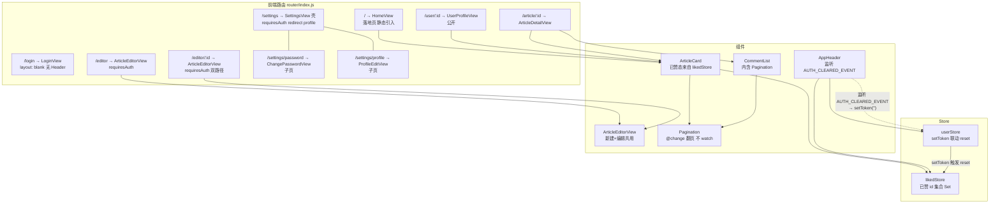

<!--
  正式文档声明（ARCHITECTURE.md）：
  - 纳入版本控制：会 commit、会 push，是仓库正式文档。
  - 可被引用：README.md / docs/AI_CONTRACT.md 等文档可链接本文件。
  - 进文档清单：docs/AI_CONTRACT.md §3 目录结构中收录本文件。
  - 定位：本文件是「视图文档」，用 Mermaid 呈现系统各维度的关系图，不是契约。
    若与 API.md（接口契约）/ DB.md（表结构）冲突，以 API.md / DB.md 为准。
  - 更新触发标准（仅结构性变更才更新）：
    ✅ 新增/删除：表、模块、页面路由、跨模块 service 复用、接口
    ❌ 不触发：改字段名、改文案、改样式、修 bug、加探针
-->

# 系统架构图（ARCHITECTURE）

> 本文档用 Mermaid 画「关系」，不重复 API.md / README / DB.md 的字段清单。
> 六张图：A 系统架构 / B 后端请求链路 / C 数据库 ER / D 用户功能地图 / E 接口全景 / F 前端路由+组件树。
> 视图文档，冲突以 API.md / DB.md 为准。

---

## A · 系统架构图

三层：前端 (Vue3) / 后端 (Express) / 数据层 (MySQL + Prisma)。标注端口、鉴权方式、静态资源路径、CORS 白名单；MySQL 层一眼看到「4 张表 + 6 个迁移」的数据规模。

---

## B · 后端请求链路图（带鉴权写请求）

以 `DELETE /api/comments/:id` 为例，画出一次写请求的完整中间件顺序与错误分支。**中间件注册顺序为 `auth` → `validate`**（见 `comment.routes.js:14`），因此未登录请求即便参数非法也先回 401。统一响应体 `{ code, message, data }`。

---

## C · 数据库 ER 图

4 张表，标出外键、唯一约束、软删列。关键差异：`users` / `articles` / `comments` 有 `deleted_at`（软删除），`likes` **没有**（物理删除，因为唯一约束 + 「点赞 = 行存在」不变式）。

> `likes` 表无 `deleted_at`：取消点赞是物理 DELETE，而非软删——避免与 `(user_id, article_id)` 唯一约束冲突（详见 DB.md 第十一批说明）。

---

## D · 用户功能地图（mindmap）

中心=已注册用户；四分支：看（公开）／写（登录）／管自己（登录）／删（登录）。画「功能 → 入口（页面/组件） → 接口」的映射，不列功能清单。

---

## E · 接口全景图（flowchart）

21 个接口按模块聚合（auth+health 5 / user 5 / article 5 / like 3 / comment 3）。画三类关系——这正是 API.md 接口表看不出来的部分：**① 模块归属独立 service**（auth 有独立 auth.service，直接碰 users 表，不经 user.service）**② 跨模块 service 复用**（article.service 导出的 `toArticleListItem / ARTICLE_DETAIL_SELECT / ARTICLE_SORT_MAP` 被 user.service 复用，第 2 批）**③ 跨 service 共享数据表**（user.service 直接查 likes 表，不经 like.service；users 表被 auth.service 与 user.service 共同直连）。所有 service 均经 Prisma 直连表，无 service 间链式调用（除第 2 批那一条复用）。不重复 API.md 接口表。

---

## F · 前端路由 + 组件树（graph）

画三类关系：**① 路由嵌套（壳+子页、双路径共用组件）② 组件复用（ArticleCard / Pagination 被哪几处用）③ store 订阅（likedStore 消费与 reset 触发链）**。不重复 README 目录。

