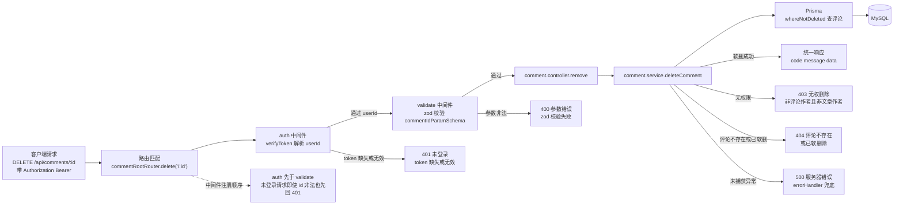
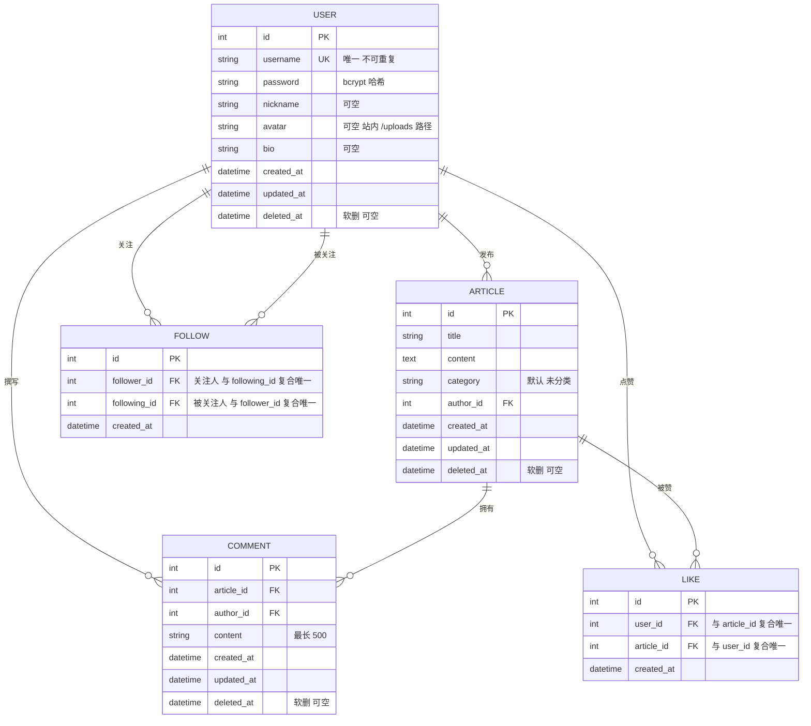
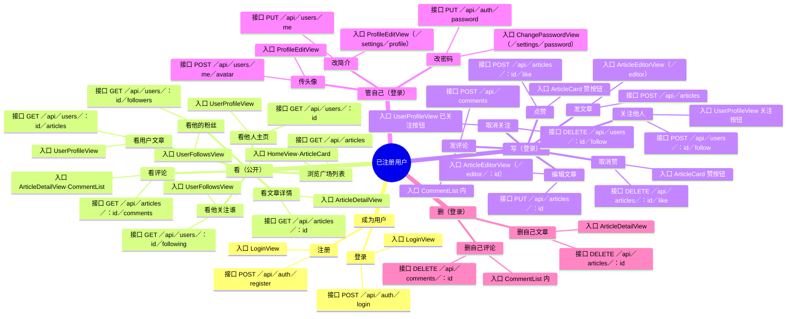
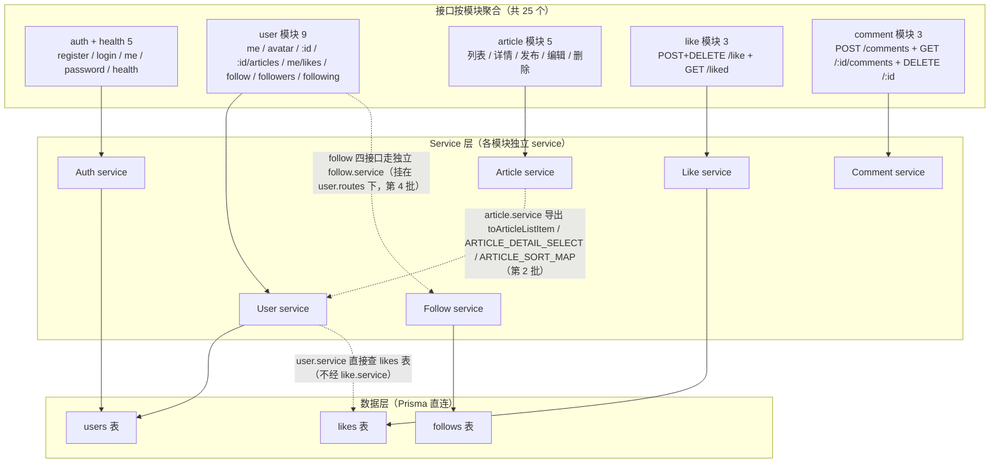

# 系统架构图（ARCHITECTURE）

> 本文档用 Mermaid 画「关系」，不重复 API.md / README / DB.md 的字段清单。  
> 六张图：A 系统架构 / B 后端请求链路 / C 数据库 ER / D 用户功能地图 / E 接口全景 / F 前端路由+组件树。  
> 视图文档，冲突以 API.md / DB.md 为准。

---

## A · 系统架构图

三层：前端 (Vue3) / 后端 (Express) / 数据层 (MySQL + Prisma)。标注端口、鉴权方式、静态资源路径、CORS 白名单；MySQL 层一眼看到「5 张表 + 7 个迁移」的数据规模。

---

## B · 后端请求链路图（带鉴权写请求）

以 `DELETE /api/comments/:id` 为例，画出一次写请求的完整中间件顺序与错误分支。**中间件注册顺序为 `auth` → `validate`**（见 `comment.routes.js:14`），因此未登录请求即便参数非法也先回 401。统一响应体 `{ code, message, data }`。

---

## C · 数据库 ER 图

5 张表，标出外键、唯一约束、软删列。关键差异：`users` / `articles` / `comments` 有 `deleted_at`（软删除），`likes` 与 `follows` **没有**（物理删除，因为唯一约束 + 「关系 = 行存在」不变式）。

> `likes` 表无 `deleted_at`：取消点赞是物理 DELETE，而非软删——避免与 `(user_id, article_id)` 唯一约束冲突（详见 DB.md 第十一批说明）。
> `follows` 表同样无 `deleted_at`：取关是物理 DELETE；`(follower_id, following_id)` 复合唯一即「一段关注关系只有一行」，重复关注由唯一约束兜底、应用层返回幂等成功（第 4 批）。

---

## D · 用户功能地图（mindmap）

中心=已注册用户；四分支：看（公开）／写（登录）／管自己（登录）／删（登录）。画「功能 → 入口（页面/组件） → 接口」的映射，不列功能清单。

---

## E · 接口全景图（flowchart）

25 个接口按模块聚合（auth+health 5 / user 9 / article 5 / like 3 / comment 3）。画四类关系——这正是 API.md 接口表看不出来的部分：**① 模块归属独立 service**（auth 有独立 auth.service，直接碰 users 表，不经 user.service）**② 跨模块 service 复用**（article.service 导出的 `toArticleListItem / ARTICLE_DETAIL_SELECT / ARTICLE_SORT_MAP` 被 user.service 复用，第 2 批）**③ 跨 service 共享数据表**（user.service 直接查 likes 表，不经 like.service；users 表被 auth.service 与 user.service 共同直连）**④ 同模块跨 service**（user 路由下的 4 个 follow 接口走独立 follow.service，挂在 user.routes.js 下但不经 user.service；follows 表只被 follow.service 直连，第 4 批）。所有 service 均经 Prisma 直连表，无 service 间链式调用（除第 2 批那一条复用）。不重复 API.md 接口表。

---

## F · 前端路由 + 组件树（graph）

画三类关系：**① 路由嵌套（壳+子页、双路径共用组件）② 组件复用（ArticleCard / Pagination 被哪几处用）③ store 订阅（likedStore / followingStore 消费与 reset 触发链）**。不重复 README 目录。

```mermaid
graph TB
  subgraph ROUTE[前端路由 router/index.js]
    rLogin["/login → LoginView\nlayout: blank 无 Header"]
    rHome["/ → HomeView\n落地页 静态引入"]
    rDetail["/article/:id → ArticleDetailView"]
    rEditor["/editor → ArticleEditorView\nrequiresAuth"]
    rEditorId["/editor/:id → ArticleEditorView\nrequiresAuth 双路径"]
    rUser["/user/:id → UserProfileView\n公开"]
    rFollows["/user/:id/follows/:type → UserFollowsView\n公开 type 白名单 beforeEnter"]
    rSettings["/settings → SettingsView 壳\nrequiresAuth redirect profile"]
    rPwd["/settings/password → ChangePasswordView\n子页"]
    rProfile["/settings/profile → ProfileEditView\n子页"]
  end

  subgraph COMP[组件]
    card["ArticleCard\n已赞态来自 likedStore"]
    editorComp["ArticleEditorView\n新建+编辑共用"]
    clist["CommentList\n内含 Pagination"]
    pag["Pagination\n@change 翻页 不 watch"]
    header["AppHeader\n监听 AUTH_CLEARED_EVENT"]
    followsComp["UserFollowsView\n粉丝/关注列表 复用 Pagination"]
    profileComp["UserProfileView\n关注按钮 + 主页入口"]
  end

  subgraph STORE[Store]
    liked["likedStore\n已赞 id 集合 Set"]
    following["followingStore\n已关注 id 集合 Set"]
    user["userStore\nsetToken 联动 reset"]
  end

  %% ① 路由嵌套 / 双路径共用
  rSettings --- rPwd
  rSettings --- rProfile
  rEditor --> editorComp
  rEditorId --> editorComp

  %% ② 组件复用
  rHome --> card
  rUser --> card
  rDetail --> card
  rDetail --> clist
  card --> pag
  clist --> pag

  %% ③ store 订阅
  card --> liked
  header --> liked
  header --> user
  user -->|setToken 触发 reset| liked
  user -->|setToken 触发 reset| following
  header -. "监听 AUTH_CLEARED_EVENT\n→ setToken('')" .-> user

  %% 第 4 批：关注链路
  rFollows --> followsComp
  rUser --> profileComp
  followsComp --> pag
  profileComp --> following
  header -. "ensureLoaded(user.id)\n按钮初始态 + 主页计数" .-> following
```

